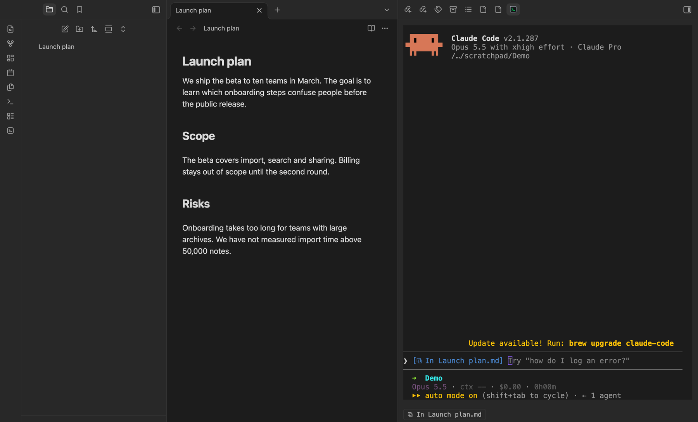
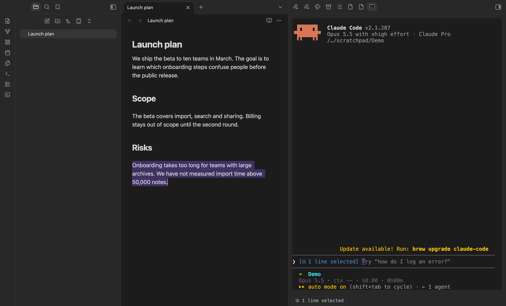
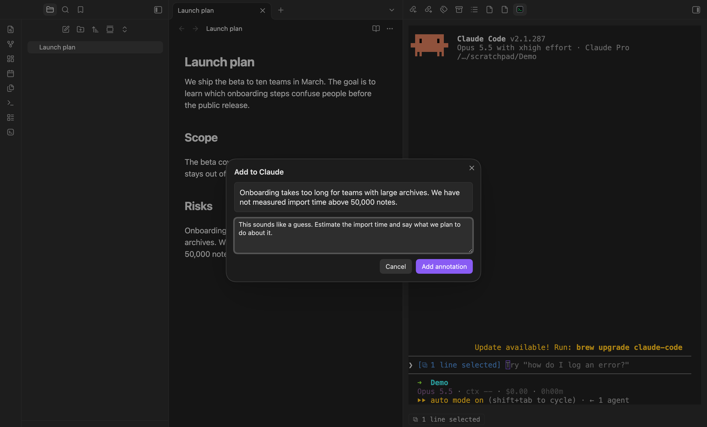
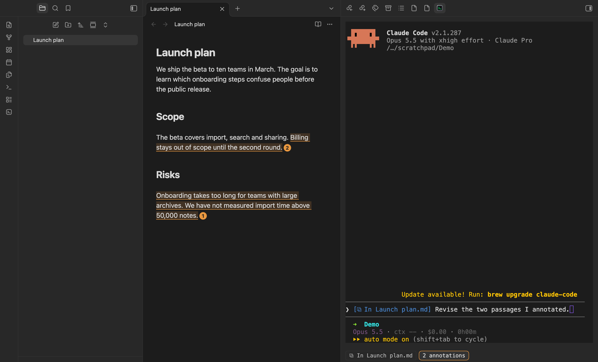
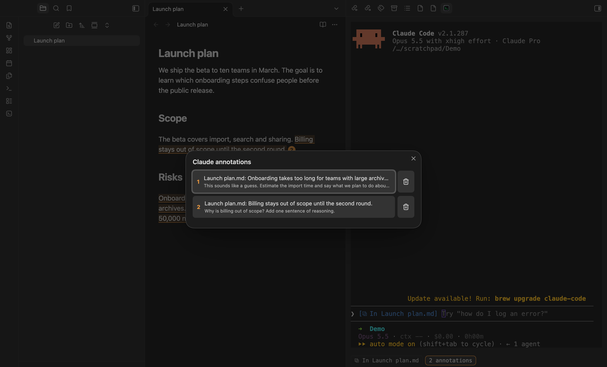

# Markup for Agents

Annotate passages in your notes and send them, with your comments, to [Claude Code](https://claude.com/claude-code) and [Codex](https://github.com/openai/codex) running in Obsidian terminals.

[简体中文](README.zh-CN.md)

## What it does

- **Annotations.** Select text, choose *Add to Claude* or *Add to Codex*, and optionally write a comment. The passage is highlighted in the note and numbered. All pending annotations ride along with your next message to that agent, together with the text you currently have selected. The terminal shows no extra text, and the annotations are dropped once the message is submitted.
- **Selection sharing.** Claude Code and Codex see the active note, the selected text and the open tabs through their own IDE integrations (`/ide`). You do not paste anything.
- **A panel under each terminal** that runs Claude Code or Codex shows what will be shared (the selection) and how many annotations are waiting. It also tells you when the agent is not connected.

## Requirements

- Obsidian 1.7.0 or later, desktop only.
- [Claude Code](https://claude.com/claude-code) and/or [Codex CLI](https://github.com/openai/codex).
- The [Terminal](https://github.com/polyipseity/obsidian-terminal) plugin, to run the agents inside Obsidian and to get the panel. Sharing the selection works from any terminal started in the vault folder.

## Quick start

### 1. Start an agent in a terminal

Install the Terminal plugin, then open a terminal at the vault root: search the command palette for `Terminal` and pick the integrated terminal opened at the vault root. Drag its tab into the right sidebar so your note and the agent sit side by side. Run `claude` or `codex` there.

### 2. Connect the IDE integration

- **Claude Code** connects by itself when *Auto-connect to IDE* is enabled (`/config`). Otherwise type `/ide`.
- **Codex** needs `/ide` once per session. Its footer shows `IDE context` when it is on.

When the connection is up, the agent's input shows which note you are in, and the panel under the terminal repeats it. Until then the panel says *Not connected* and tells you to type `/ide`.

### 3. Select text in a note

Whatever you select in the editor is what the agent sees. The input and the panel show it, for example *1 line selected*. There is nothing to paste.

### 4. Add an annotation

With text selected, right-click and choose *Add to Claude* (or *Add to Codex*), or run the same command from the command palette. Write a comment and press *Add annotation*.

The passage is highlighted and numbered in the note, and the panel counts the annotations waiting for that agent. Add as many as you like, in as many notes as you like.

### 5. Review, jump and edit

Click the annotation count in the panel to open the list. Click an entry to jump to that passage in its note, or use the trash button to remove it. Click a numbered badge in the note to edit or remove the annotation. Deleting the annotated text removes its annotation.

### 6. Send

Write your message in the terminal and press Enter. All pending annotations travel with it, together with your current selection, and are cleared once the message is submitted.

### 7. Optional: set a hotkey

No hotkeys are set by default. Open *Settings → Hotkeys*, search for `Markup for Agents`, and assign keys to *Add to Claude* and *Add to Codex*, for example `Cmd+Alt+C` and `Cmd+Alt+X`. They also work while a terminal has focus.

## Commands

| Command | Action |
| --- | --- |
| Add to Claude / Add to Codex | Annotate the selected text |
| Mention selection in Claude | Send an `@` reference to the selection to Claude Code |
| Restart Codex IDE server | Reconnect the Codex channel |

## What it touches on your machine

- Starts a WebSocket server on `127.0.0.1` (random port, protected by a token) and writes `~/.claude/ide/<port>.lock` so that Claude Code finds it. The file is removed when the plugin unloads.
- For Codex, answers on Codex's local IPC channel (`~/.codex/ipc/ipc.sock`, or `\\.\pipe\codex-ipc` on Windows). If another program such as the Codex desktop app already owns that channel, the plugin joins it as a client instead of competing.
- Reads the visible screen of terminals to see the agent's input and footer, and runs `ps` to tell which terminal runs which agent.
- Makes no network requests. The only data that leaves Obsidian is what you hand to the agents: the selected text, open tab names and annotations.

## Limitations

- The Claude Code and Codex IDE protocols are not formally documented. This plugin follows their observed behaviour and may break when they change.
- The panel relies on the Terminal plugin's internal terminal object.
- Windows support follows Codex's named-pipe design but has not been tested.

## License

[MIT](LICENSE)
