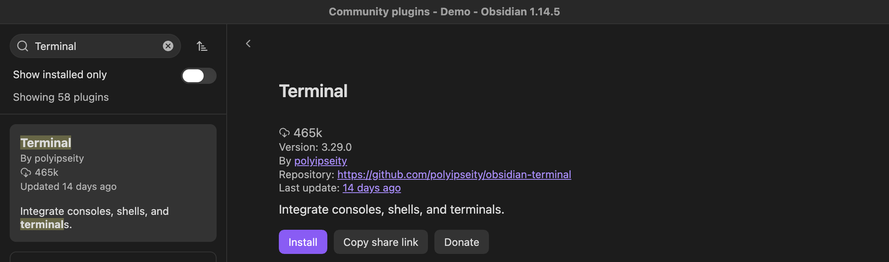
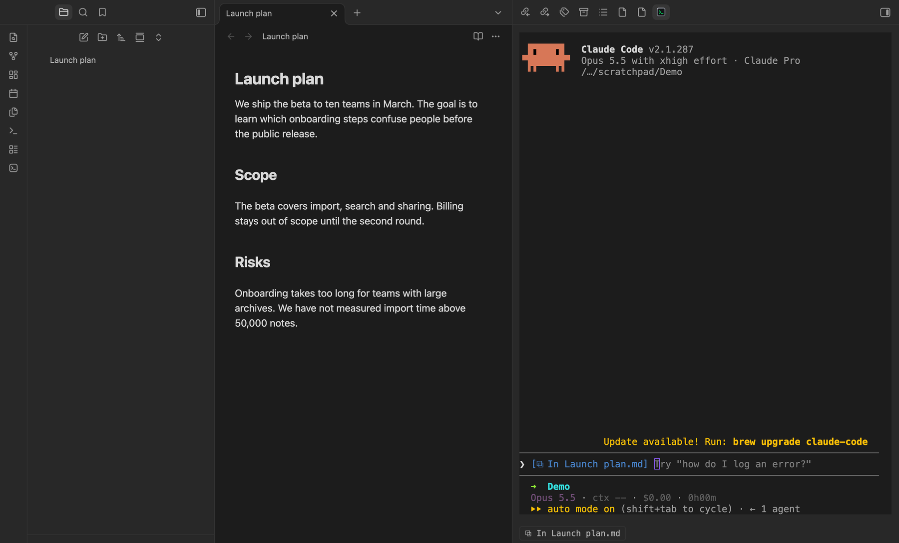
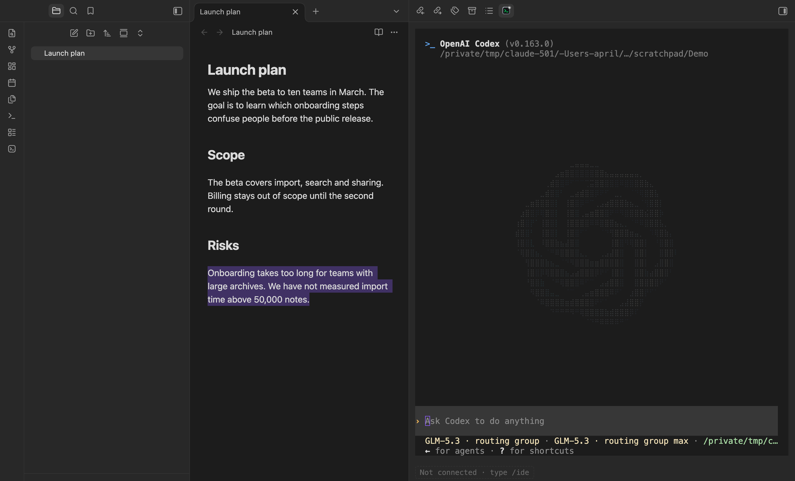
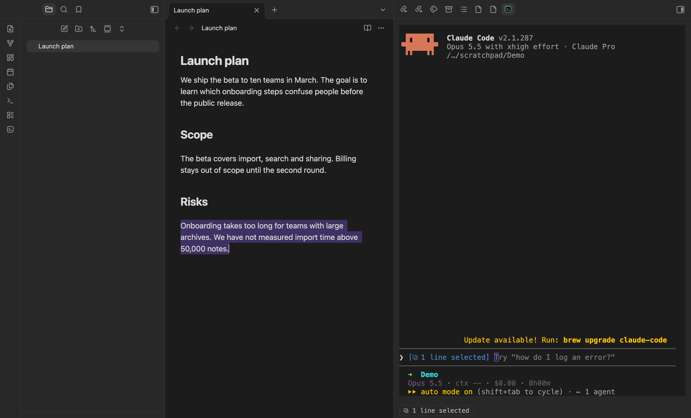
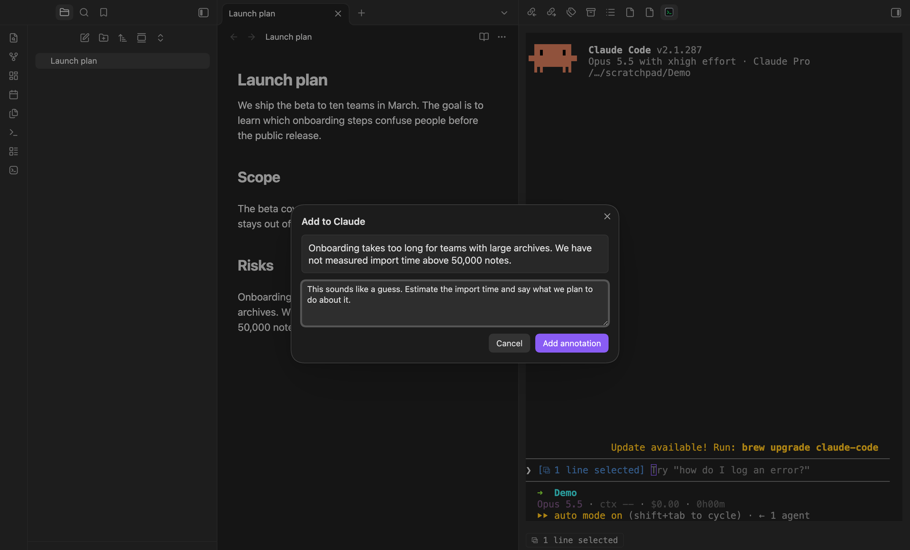
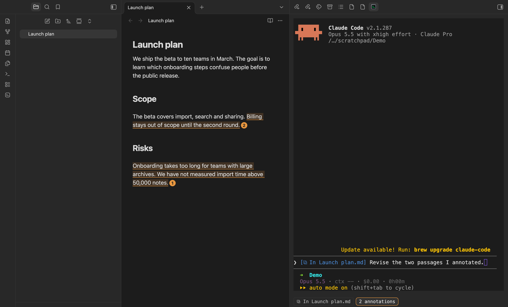
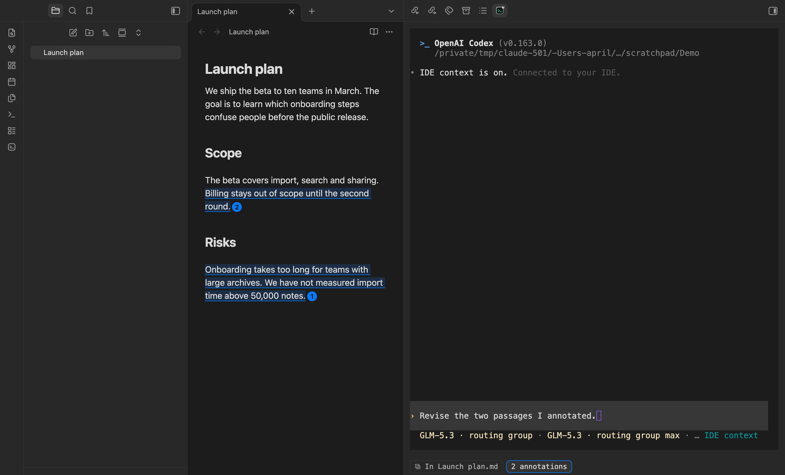
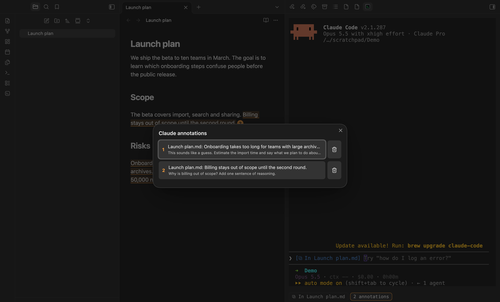

# Markup for Agents

给笔记里的段落加批注，连同你的评论一起发给在 Obsidian 终端里运行的 [Claude Code](https://claude.com/claude-code) 和 [Codex](https://github.com/openai/codex)。

[English](README.md)

## 功能

- **批注。** 选中文字，选择 *添加到 Claude* 或 *添加到 Codex*，可以写一句评论。被批注的文字会在笔记里高亮并编号。所有待发批注会连同你当前选中的文字，随你发给该助手的下一条消息一起送出，终端里不会出现多余的文本，消息提交后批注自动清除。
- **选区共享。** Claude Code 和 Codex 通过各自的 IDE 集成（`/ide`）看到当前笔记、选中的文字和打开的标签，不需要手动粘贴。
- **终端下方的面板。** 运行 Claude Code 或 Codex 的终端下面会显示将要共享的选区、等待发送的批注数量，助手未连接时也会提示。

## 要求

- Obsidian 1.7.0 及以上，仅桌面端。
- 已安装 [Claude Code](https://claude.com/claude-code) 和/或 [Codex CLI](https://github.com/openai/codex)。
- [Terminal](https://github.com/polyipseity/obsidian-terminal) 插件，用于在 Obsidian 里运行助手并显示面板。选区共享在任何以 Vault 目录为工作目录的终端里都能用。

## 快速上手

### 1. 安装 Terminal 插件

Markup for Agents 配合你在 Obsidian 终端里运行的助手使用，终端由 [Terminal](https://github.com/polyipseity/obsidian-terminal) 插件提供，需要先安装它：打开 *设置 → 第三方插件 → 浏览*，搜索 `Terminal`，安装 polyipseity 发布的那一个并启用。

### 2. 在终端里启动助手

在 Vault 根目录打开终端：在命令面板里搜索 `Terminal`，选择在根目录打开的整合式终端。把它的标签拖到右侧边栏，笔记和助手就并排了。在里面运行 `claude` 或 `codex`。

### 3. 连接 IDE 集成

- **Claude Code**：开启 *Auto-connect to IDE*（`/config`）后自动连接，否则输入 `/ide`。
- **Codex**：每个会话输入一次 `/ide`。开启后它的底部栏会显示 `IDE context`。

连上之后，助手的输入框会显示你当前所在的笔记，终端下方的面板同步显示。

没连上时，面板会提示 *未连接*，并告诉你输入 `/ide`。这是 Codex 在输入 `/ide` 之前的样子：

### 4. 在笔记里选中文字

你在编辑器里选中什么，助手就看到什么。输入框和面板会显示选区，例如 *1 line selected*。不需要粘贴。

### 5. 添加批注

选中文字后，右键选择 *添加到 Claude*（或 *添加到 Codex*），也可以在命令面板里运行同名命令。写一句评论，点 *添加批注*。

被批注的文字会在笔记里高亮并编号，面板会统计等待发给该助手的批注数量。可以添加任意多条，也可以跨多篇笔记。Claude 的批注是橙色。

Codex 的批注是蓝色。输入 `/ide` 之后，Codex 的底部栏会显示 `IDE context`，面板显示当前笔记和等待发送的批注。

### 6. 查看、跳转和编辑

点击面板里的批注数量打开列表。点某一条就会跳转到笔记里对应的段落，点垃圾桶按钮删除它。点击笔记里的编号标记可以编辑或删除批注。把被批注的文字整段删掉，对应的批注也会一起消失。

### 7. 发送

在终端里写消息并回车。所有待发批注会连同你当前的选区一起送出，消息提交后自动清除。

### 8. 可选：设置快捷键

默认不设置任何快捷键。打开 *设置 → 快捷键*，搜索 `Markup for Agents`，给 *添加到 Claude* 和 *添加到 Codex* 指定按键，例如 `Cmd+Alt+C` 和 `Cmd+Alt+X`。焦点在终端里时也有效。

## 命令

| 命令 | 作用 |
| --- | --- |
| 添加到 Claude / 添加到 Codex | 给选中的文字加批注 |
| 在 Claude 中提及选区 | 向 Claude Code 发送选区的 `@` 引用 |
| 重启 Codex IDE 服务 | 重新连接 Codex 通道 |

## 它在你的电脑上做了什么

- 在 `127.0.0.1` 启动 WebSocket 服务（随机端口，带令牌校验），并写入 `~/.claude/ide/<端口>.lock` 让 Claude Code 发现它，插件卸载时删除。
- 对 Codex，在其本地 IPC 通道（`~/.codex/ipc/ipc.sock`，Windows 为 `\\.\pipe\codex-ipc`）上应答。如果通道已被其他程序（例如 Codex 桌面端）占用，插件会作为客户端加入而不是争抢。
- 读取终端可见屏幕以获得助手的输入框和底部栏状态，并用 `ps` 判断每个终端运行的是哪个助手。
- 不发起任何网络请求。离开 Obsidian 的只有你交给助手的内容：选中的文字、打开的标签名和批注。

## 限制

- Claude Code 和 Codex 的 IDE 协议没有正式文档，本插件依据实际行为实现，对方变更协议时可能失效。
- 面板依赖 Terminal 插件的内部终端对象。
- Windows 按 Codex 的命名管道设计实现，但未经测试。

## 许可证

[MIT](LICENSE)
